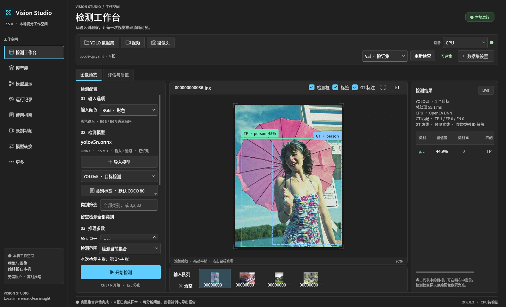
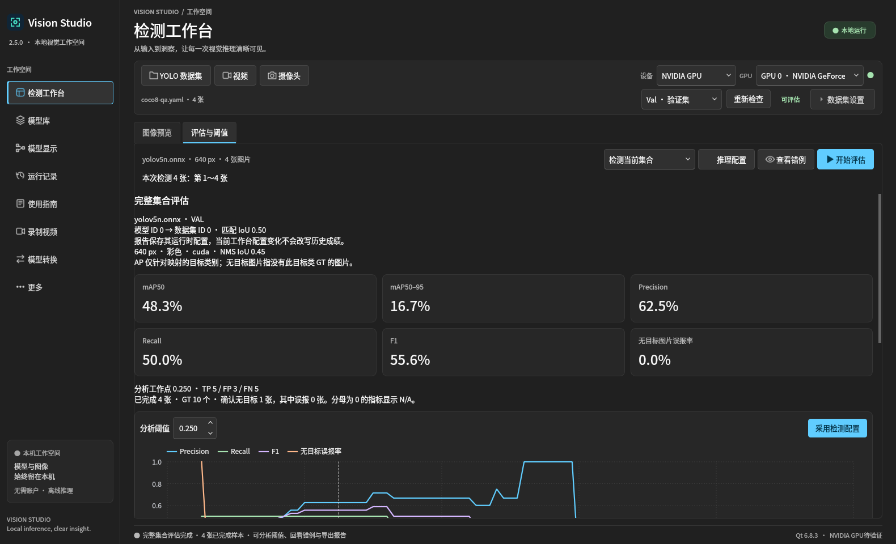
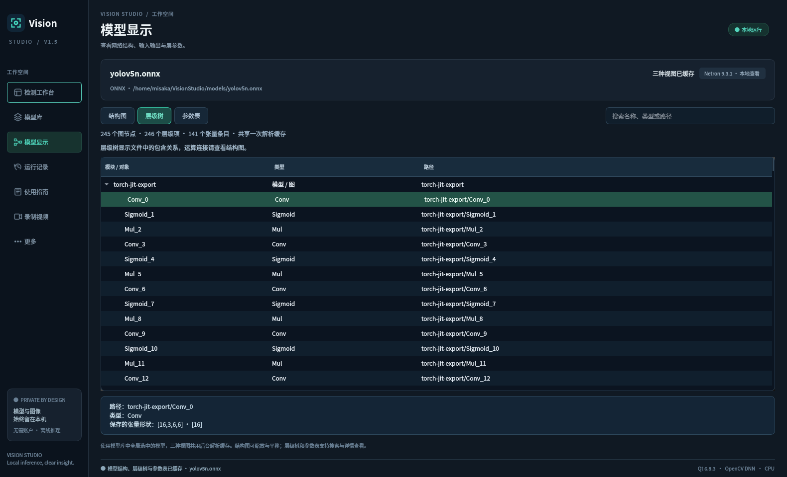
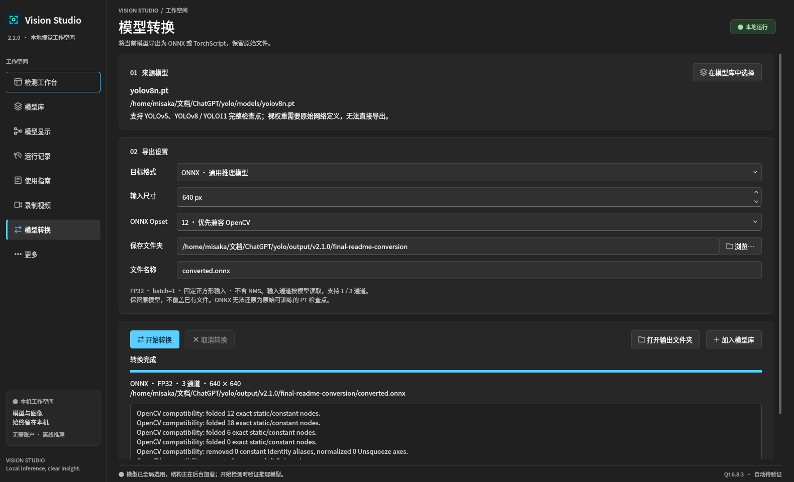

# Vision Studio

📺 **[B 站视频介绍 · 点击观看](https://www.bilibili.com/video/BV1s8pe6cEXb/)**

欢迎来 B 站看看我的 Vision Studio 项目介绍！如果觉得有帮助，欢迎**点赞、投币、收藏**支持，也欢迎在评论区交流使用体验和改进建议。

**基于 C++17 / Qt 6.8 的本地 YOLO 推理、评估调优、模型可视化与转换工具。** 支持 ONNX / PT 模型、标准 YOLO 数据集检测与评估、视频和摄像头输入、灰度与左右目处理、标注视频录制，以及结构图、层级树和参数表。

[下载发行版](https://github.com/misaka-ning/vision-studio/releases) · [更新日志](CHANGELOG.md) · [使用指南](docs/使用指南.md) · [报告问题](https://github.com/misaka-ning/vision-studio/issues)

当前工程版本：**2.5.0**。数据集文件夹和 YAML 共用一个导入选择器；缩略图按可见范围后台读取，原图与结果回看异步加载，大队列分片填入界面。工作台拆分为占用完整工作区的「图像预览」和「评估与阈值」两个子页，数据集设置改为悬浮卡片，切页只改变查看位置，任务配置、预测缓存和历史报告保持独立。在同一工作台串联「导入带标注数据集 → 评估目标类 → 分析阈值与错例 → 采用检测配置」。界面保留 [Fluent-Qt](https://github.com/calvinhxx/Fluent-Qt) 风格，复用全局模型与现有推理后端。本次发行平台：**Ubuntu 22.04 LTS amd64**；安装文件以 Releases 实际发布为准。Windows 已发布安装包仍为 2.1.0 补充版，本版不宣称完成 Windows 2.5.0 验收。应用代码采用 **AGPL-3.0-only**。

本版已完成有效 18 套回归（305 项 Qt、101 项 Python）、真实 CPU／CUDA、最终包与对应源码验收；有效结果由原 17 套通过加相同 38 项 scope CPU 复验组成，并非一次完整 18 套全部通过，初轮失败记录保留。当前宿主升级等待 Polkit，GitHub 发布与旧版清理另按完成凭证记录。[验收详情与边界](docs/releases/evidence/2.5.0/README.md)。





以上为最终 2.5.0 只读 DEB 的实际 Qt 窗口，使用公开 COCO8 四张 Val 图片和随附 YOLOv5n 模型，分别展示 CPU 图像预览与 CUDA「评估与阈值」。截图用于展示界面和管线，不是足球精度或部署性能基准；工作台页脚的设备验证提示是该页实时状态，实际后端以报告为准。来源、原始日志及限制见 [2.5.0 验收证据](docs/releases/evidence/2.5.0/README.md)。

## 功能

- **检测工作台**：输入集中为 YOLO 数据集、视频和摄像头。数据集图片沿用队列及「检测当前集合」／从当前向后／仅当前三种检测范围；默认只处理当前选择的 Train／Val／Test 集合，开始时冻结范围和顺序；保留结果回看、停止后已完成结果和所选图片导出。独立图片、普通图片文件夹、图片拖入和公开示例入口退出支持，启动时不自动载入示例图。YOLO 检测与单标签图像分类后端保留，置信度和 NMS IoU 可调；关键数值控件不受鼠标滚轮误改，保存仍在后台完成。
- **数据集与评估调优**：点击「YOLO 数据集」或按 Ctrl+O，在同一个选择器导入数据集文件夹或现有 YAML；单击目录后确认导入，双击仍可浏览目录，无需先选输入类型。优先识别根目录唯一的 `data.yaml`／`data.yml`／`dataset.yaml`／`dataset.yml`，配置歧义时提示明确选文件。数据集上下文保留单行摘要、集合和检查状态，点击「数据集设置」打开锚定按钮的悬浮卡片，修改类别映射、可选 metadata 与扫描参数；点击外部、Esc 或再次点击按钮可关闭，不挤压预览。选择 Val／Test／Train，复用图片队列、三种检测范围和画布；「图像预览」查看 GT 与预测，「评估与阈值」提供独立的开始评估操作，后台采集低分候选并计算目标类 AP50／AP50–95、固定阈值 P／R／F1、TP／FP／FN 与无目标图片误报率。单目标原始类别映射兼容 COCO 模型与自训练模型，缺标签阻止评估，不把它当作负样本。
- **大队列与页面分工**：队列按 GUI 事件循环分片建立，缩略图仅按可见项及邻近范围在后台解码，选中的原图与缓存叠加也异步读取；切换选择、颜色或来源后拒绝过期回调，避免把上一张图片显示到新选择。检测子页完整保留参数、画布、队列和目标列表；评估子页使用完整工作区显示曲线、指标、错例与报告。只切子页不改阈值或模式，不清空缓存，也不启动推理。
- **阈值与错例联动**：默认扫描 0.05～0.95、步长 0.01 的 91 个工作点，可调整扫描范围；曲线、明细、指标与误检／漏检队列联动，使用同一次推理缓存。完整 Val 评估可按 F1、最低 Precision 或最高误报率约束选择工作点；只有明确点击「采用检测配置」才更新工作台阈值、原始类别、预处理与设备。评估报告持久保存，运行记录与模型库可重新打开。
- **类别筛选**：独立输入原始类别 ID，留空为全部，支持 `32`、`0,2,32`、空格和中文逗号，自动去重；后台读取模型实际类别范围，非法 ID 通过行内提示阻止开始。检测框、表格、数量、导出与录像使用同一筛选结果，不重编号；分类任务禁用该控件。COCO ID 32 是 sports ball，涵盖多种球类，并非只识别足球。
- **模型库**：导入 ONNX / PT / TorchScript，可拖动排序并在重启后保留；右键打开模型位置、编辑备注、更改显示名称或从列表移除。显示名称与备注持久保存，重命名不改原始文件名与内容，移除保留文件；全局选用统一决定工作台、模型显示与转换页默认来源。
- **模型显示**：Netron 结构图、可展开层级树、参数表；后台预加载并缓存，切换页面与模式复用解析结果，树与表支持搜索和详情。
- **灰度与双目输入**：灰度按模型的 1 / 3 通道适配；单设备水平左右拼接视频或摄像头可只处理左目或右目。预览和导出显示实际所选画面与颜色模式。
- **标注与录制**：检测框、类别、置信度、缩放和平移；保存 PNG / JSON / CSV，自动保存选项下方可直接打开结果目录。视频和摄像头可开始／结束录制，在「录制视频」页浏览、播放和导出。
- **模型转换**：新页面位于「录制视频」之后、「更多」之前，将受支持的 PT 转换为 ONNX 或 TorchScript，提供后台进度、日志、取消、打开输出目录与完成后加入模型库。导出 CPU FP32、batch=1、固定正方形输入、不含 NMS，保留 C1 / C3；ONNX 可选 Opset 12 / 17，已有文件拒绝覆盖。
- **运行记录与更多**：保留处理记录、模型和耗时；双击评估记录重新打开独立报告与预测缓存；「更多」集中提供 GPU 环境管理与手动导出。
- **计算设备**：工作台可选自动、CPU 或 NVIDIA GPU；「更多」检查并准备独立 GPU 环境。自动模式在 GPU 不可用时显示原因并使用 CPU，显式 GPU 失败时报告错误；结果记录实际设备。



普通 PT 的层级树表示文件可解析的模块包含关系，裸权重按名称分组；参数表列出权重、常量和缓冲，不能直接作为可训练参数总量。ONNX 更适合查看完整运算连接。不支持或损坏的模型会显示文字说明。详细范围见 [模型说明](docs/模型说明.md)。



## 下载与安装

从 [GitHub Releases](https://github.com/misaka-ning/vision-studio/releases) 选择已发布版本，以下命令用于 2.5.0 正式发布后安装。每版只上传 **3 个手动附件**：安装包 `.deb`、`vision-studio-X.Y.Z-complete-source.tar.xz`、`SHA256SUMS`。

页面另外显示 GitHub 自动提供的 **Source code (zip)** 和 **Source code (tar.gz)** 两个源码入口，它们由平台生成，不能从 Release 中移除。下载三个手动附件后，先校验，再安装：

```bash
sha256sum -c SHA256SUMS
sudo apt install ./vision-studio_2.5.0-1_amd64.deb
vision-studio
```

2.5.0 正式包的 Debian 版本为 `2.5.0-1`，高于 `2.4.0-1` 及此前版本，可用以上 APT 命令直接升级。先结束检测、评估、录像与模型转换，导出需要永久保存的结果，退出旧程序再安装；升级保留个人设置、模型、运行记录、导出、录像、评估报告与已准备的 GPU 环境。普通检测临时缓存不会跨程序重启保留，评估报告及其预测快照独立持久保存。

也可从应用菜单启动 **Vision Studio**。先在模型库选用模型，再导入标准 YOLO 数据集，或选择视频／摄像头。Ctrl+O 打开文件夹与 YAML 共用的数据集选择器；不再提供普通图片、图片文件夹、图片拖入、更多页示例和 `--demo`／`--pt-demo` 启动选项。

程序安装到 `/opt/VisionStudio`，设置、运行记录、导出、录像和评估位于 `${XDG_DATA_HOME:-$HOME/.local/share}/vision-studio`。转换模型默认位于该目录的 `converted-models/`，也可指定其他可写文件夹；评估任务保存在 `evaluations/<任务ID>/`。普通用户无需向安装目录写入文件。`VISION_STUDIO_DATA_DIR` 可指定另一数据目录。卸载应用使用 `sudo apt remove vision-studio`，个人数据由用户保留或自行清理。

正式 DEB 包含 Qt 6.8.3 / WebEngine、独立 CPU PyTorch 环境、Netron 9.3.1 与本地示例模型，模型准备完成后可以离线使用；APT 可能需要安装包声明的系统共享库。Git checkout 与便携打包脚本生成的目录需要自行准备 runtime，不能直接当作完整 DEB 安装环境。

V1.6 的 NVIDIA GPU 支持首次需在「更多」点击「准备 GPU 支持」，从官方源下载约 4–5 GB 锁定依赖，建议预留至少 20 GB 空间。配置写入个人数据目录的 `gpu-runtime/`，可以取消；只有实际 CUDA 自检成功才发布环境，失败保留原来的 CPU／GPU 环境。不安装或修改显卡驱动，不在 APT／DPKG 安装过程中下载 CUDA。GPU 准备完成后模型推理可离线执行。

## 推理架构与兼容范围

| 用途 | 实现 | 当前设备 |
| --- | --- | --- |
| 界面、输入、结果显示、录制与导出 | C++17 / Qt 6.8.3 | 本机 |
| ONNX CPU 推理 | C++ / OpenCV DNN 4.5.4 | CPU |
| ONNX GPU 推理 | C++ / ONNX Runtime 1.23.2 CUDA Execution Provider | NVIDIA GPU，可选环境 |
| PT 推理 | 常驻本地 Python / PyTorch 2.9.1 / Ultralytics 8.4.173 | CPU；可选 CUDA 12.8 |
| 模型结构显示 | Qt WebEngine / Netron 9.3.1，本机回环服务 | 本机 |
| PT → ONNX / TorchScript 转换 | 后台 Python / PyTorch；ONNX 1.17.0 / protobuf 6.33.0 | CPU，独立于工作台推理设备 |
| 数据集评估 | Qt 工作线程调度现有推理后端；独立 Python 计算匹配、AP 与阈值统计 | 沿用所选 CPU／NVIDIA GPU；指标计算使用 CPU |

V1.6 增加 NVIDIA CUDA 后端，TensorRT、AMD 与 Intel GPU 尚未提供。GPU 环境固定为 Python 3.10／3.11、PyTorch `2.9.1+cu128`、Torchvision `0.24.1+cu128`、CUDA 12.8、cuDNN 9.10.2 与 ONNX Runtime 1.23.2；推荐 Linux NVIDIA 驱动 ≥ 570.26。`nvidia-smi` 的 CUDA Version 表示驱动支持上限，不代表已安装 CUDA Toolkit。应用使用官方运行库 wheel，无需全局 Toolkit。[PyTorch 版本](https://pytorch.org/get-started/previous-versions/)、[ORT CUDA 兼容](https://onnxruntime.ai/docs/execution-providers/CUDA-ExecutionProvider.html)、[CUDA 12.8 驱动要求](https://docs.nvidia.com/cuda/archive/12.8.0/cuda-toolkit-release-notes/index.html)。

模型可视化不参与检测推理，结构查看不会执行 `torch.load`；PT 推理加载检查点可能执行其 Python 代码，请使用自己训练或可信来源的模型。

评估首版针对**单一目标类别**，保留模型原始 ID，并映射到一个数据集类别。例如模型 ID 32 `sports ball` → 数据集 ID 0 `football`；这不会改变模型本身的类别语义。界面的 mAP50／mAP50–95 表示此目标类的 AP，并非多类总体 mAP。AP 使用低阈值候选，P／R／F1 使用当前分析阈值；负样本误报率是「出现至少一个目标误报的确认无目标图片数 ÷ 确认无目标图片数」，零分母显示 N/A。仅完整完成且超过一张图片的集合显示主 AP；子集、单图和中断任务明确标记范围。

评估固定使用完整图片坐标、最低置信度 0.001、每图最多 300 个 NMS 后目标候选和 30000 个 NMS 前候选上限，复用输入尺寸、颜色、灰度 C1／C3、NMS 与设备设置。扫描可复用候选，改变模型、数据、尺寸、预处理或 NMS 后需重新推理；本版不提供 NMS 扫描、分类评估、多类总体评估、裁剪评估、模型训练及视频／摄像头在线 mAP。普通推理功能不受这些评估边界影响。

ONNX 支持符合本项目输入输出约定的 YOLOv5、YOLOv8 / YOLO11 原始检测输出与单标签分类；CPU 与 GPU 的模型算子分别以 OpenCV DNN、ONNX Runtime CUDA 支持范围为准。图像输入需为 NCHW，固定 1 或 3 通道；灰度直接输入 C1 或复制到 C3，彩色要求 C3。带内置 NMS、多输入、分割、姿态、旋转框和量化专用预处理不在当前兼容范围。

PT 支持兼容的 Ultralytics YOLOv8 / YOLO11 完整检查点、随附 YOLOv5 v7.0 框架可加载的旧版完整检查点，以及带必要任务、类别和通道元数据的标准 TorchScript。裸 `state_dict` 可显示静态信息，但还需要网络架构才能推理。具体预处理、灰度、左右目和输出约定请阅读 [模型说明](docs/模型说明.md) 和 [使用指南](docs/使用指南.md)。

模型转换支持现代 Ultralytics 检测／分类、兼容 YOLOv5 检测及带任务、类别和通道信息的标准 TorchScript。保留任务、类别与输入通道元数据；TorchScript 归档包含 `config.txt`。通过转换页加入库时记录结果配置，选用时应用任务、类别、尺寸与默认归一化，手工标签优先；C1 自动选择灰度，C3 仍需按训练预处理选择颜色模式。本次转换来源在开始时固定，完成后须明确入库才改变全局模型。

转换器针对旧版 OpenCV 的部分静态形状与广播限制做等价规约，输出仍为标准 ONNX，保存前检查图并比较 Python OpenCV CPU 输出。系统 C++ OpenCV、真实图片及 GPU 后端仍需分别验证。裸权重或未知自定义网络需要原始定义，本版不提供 ONNX → PT 图转换或原始训练检查点还原；固定输入跟踪不保留任意动态控制流或训练功能。取消时保留源文件与已有输出；若完整结果已在取消请求前写出，界面提示完成或保留，详见 [转换步骤](docs/使用指南.md#转换模型)。

## 从源码构建

### Windows 本地开发

Windows 2.1.0 已在对应环境使用 Qt 6.8.3 MSVC 2022 64 位 SDK、MSVC x64 和 OpenCV 4.12.0 Windows 动态库完成构建及真实 ONNX CPU 示例验证；以下是源码构建方法，不代表本轮已验收 Windows 2.5.0。Qt 需安装 WebEngine、WebChannel、Svg 及其配套模块。请在 Visual Studio x64 开发者终端中执行，按实际安装位置调整路径：

```powershell
cmake -S . -B build-windows -G Ninja -DCMAKE_BUILD_TYPE=Release -DBUILD_TESTING=ON -DCMAKE_PREFIX_PATH=D:/Qt/6.8.3/msvc2022_64 -DOpenCV_DIR=D:/Opencv-C++/opencv/build/x64/vc16/lib
cmake --build build-windows --target vision-studio --parallel 4
D:/Qt/6.8.3/msvc2022_64/bin/windeployqt.exe --release build-windows/bin/vision-studio.exe
# 将相应 OpenCV 的 opencv_world DLL 和 videoio_ffmpeg DLL 复制到 build-windows/bin
./build-windows/bin/vision-studio.exe --device cpu
```

开发构建可直接双击 `build-windows/bin/vision-studio.exe`，但该目录仍依赖项目资源。需要分发时使用 [Windows 完整打包流程](packaging/windows/README.md)，生成包含 Qt、OpenCV、独立 Python、PT／Netron／转换依赖、模型与文档的单文件安装器。默认安装到 `C:\Users\用户名\VisionStudio`，可自选目录，无需接收者配置开发环境。用户数据独立保存在 `%LOCALAPPDATA%\vision-studio`，卸载保留个人文件。

Windows 使用独立的 CUDA wheel 哈希锁和 GPU 准备流程，首次准备需要网络及兼容的 NVIDIA 显卡驱动；不复用 Linux runtime，不安装或修改驱动。CPU、模型显示与转换可在安装后离线使用。Windows 验收材料单独保存在 `docs/releases/evidence/2.1.0/windows/`，不替代或修改现有 Linux 发行证据。

### Linux

依赖 CMake ≥ 3.21、C++17 编译器、Ninja、Qt 6.8.3 SDK，以及 OpenCV Core / Imgproc / Imgcodecs / Videoio / DNN。Qt 模块为 Core、Gui、Widgets、Svg、Network、WebChannel、WebEngineWidgets，测试还需要 Test；WebEngine 需要配套的 Quick / Qml / Positioning 模块及资源。

```bash
git clone https://github.com/misaka-ning/vision-studio.git
cd vision-studio

# Python 3.10 或 3.11，需要 venv；首次准备会下载依赖
./scripts/setup_pt.sh

# QT_PREFIX 可按本机 SDK 位置修改
QT_PREFIX="$HOME/Qt/6.8.3/gcc_64" ./scripts/build.sh
./build/bin/vision-studio
```

示例模型和测试资源保留在仓库中。`scripts/build.sh` 完成 CMake 配置、构建与 CTest。也可直接使用 CMake：

```bash
cmake -S . -B build -G Ninja -DCMAKE_BUILD_TYPE=Release \
  -DCMAKE_PREFIX_PATH="$HOME/Qt/6.8.3/gcc_64" -DBUILD_TESTING=ON
cmake --build build --parallel 4
ctest --test-dir build --output-on-failure
```

源码开发的 PT / Netron 依赖由 `requirements-pt.txt` 和 `requirements-pt.lock.txt` 约束；正式 DEB 使用的 headless OpenCV runtime 另有 [发行依赖锁](docs/release/requirements-release.lock.txt)。`VISION_STUDIO_BASE_PYTHON` 可指定建立 runtime 的 Python，`VISION_STUDIO_PYTHON` 可指定运行时解释器的绝对路径。

GPU 依赖使用独立的 `requirements-gpu.txt`／`requirements-gpu.lock.txt`；完整锁包含版本与官方 wheel 的 SHA256，按 `--no-deps --require-hashes` 安装，避免 Ultralytics 额外装入 GUI OpenCV。源码开发也可执行：

```bash
./scripts/setup_gpu.sh
/usr/bin/python3.10 scripts/gpu_probe.py
```

默认解释器明确使用 `/usr/bin/python3.10`，不跟随 PATH 中的 Conda。可用 `--base-python /绝对路径/python3.11`、`--runtime-dir /用户专用目录/gpu-runtime` 指定配置位置，并用 `VISION_STUDIO_GPU_RUNTIME_DIR` 在应用中选择同一目录。Netron 继续使用独立 CPU 环境。

## 验证与发行

2.5.0 的实际测试范围、原始日志、最终 DEB、安装、CPU／CUDA、数据集评估与对应源码检查保存在 [本版验收证据](docs/releases/evidence/2.5.0/)；发行说明见 [2.5.0](docs/releases/2.5.0.md)。只有本版最终文件完成适用核验后才发布，执行结果以同版报告为准，不提前将开发构建或旧版报告视为安装包验收。物理摄像头和 Windows 2.5.0 不作为已测试项目。

普通检测在同一配置下逐图更新结果，停止前未重算的图片与范围外有效缓存保留；修改模型、预处理、阈值、设备、类别名称映射或类别筛选会清除不兼容的临时缓存。评估使用独立配置、标注和预测快照，历史统计不会被新配置改写。源文件内容变化会阻止新任务作为有效评估发布；历史图像叠加仍需核对原图哈希，原图已移动或改变时保留统计并提示，避免错配。范围及筛选组合、超过 50 张、停止后回看、零匹配、类别映射与原始 ID 保留均属于验证范围。

```bash
./build/bin/vision-studio --smoke /tmp/vision-studio-onnx-smoke
./build/bin/vision-studio --smoke-pt /tmp/vision-studio-pt-smoke
./build/bin/vision-studio --smoke-model /tmp/vision-studio-model-smoke
```

发布按 [版本管理](docs/版本管理.md) 执行：源码与带说明标签 `v2.5.0` 推送，三个手动附件远端核验成功后才清理旧发行／独立构建副本，届时本地保留 2.5.0 与 2.4.0；完成前继续保留现有发行备份。用户设置、模型、评估、录像、共享 SDK／runtime 及未备份资料保留。历史 [2.4.0](docs/releases/2.4.0.md)、[2.3.1](docs/releases/2.3.1.md)、[2.3.0](docs/releases/2.3.0.md)、[2.2.0](docs/releases/2.2.0.md)、[2.1.0](docs/releases/2.1.0.md) 及其原始证据和归档保持不变。

## 文档、贡献与许可

- [使用指南](docs/使用指南.md)、[模型说明](docs/模型说明.md)、[UI 设计](docs/UI设计.md)
- [更新日志](CHANGELOG.md)、[参与贡献](CONTRIBUTING.md)、[版本管理](docs/版本管理.md)
- [第三方许可清单](docs/release/第三方许可清单.md)、[对应源码与重建](docs/release/对应源码与重建.md)

欢迎提交 [Issue](https://github.com/misaka-ning/vision-studio/issues) 或 Pull Request。维护者：**misaka_ning <1468549029@qq.com>**。

新编写的应用代码按 **AGPL-3.0-only** 发布，完整正文见 [LICENSE](LICENSE)。Qt、Ultralytics、YOLOv5、Netron、示例模型和其他组件保留各自许可；通知与正文位于 `packaging/licenses/`。转发发行版时请继续提供对应源码、原始通知与校验文件。
