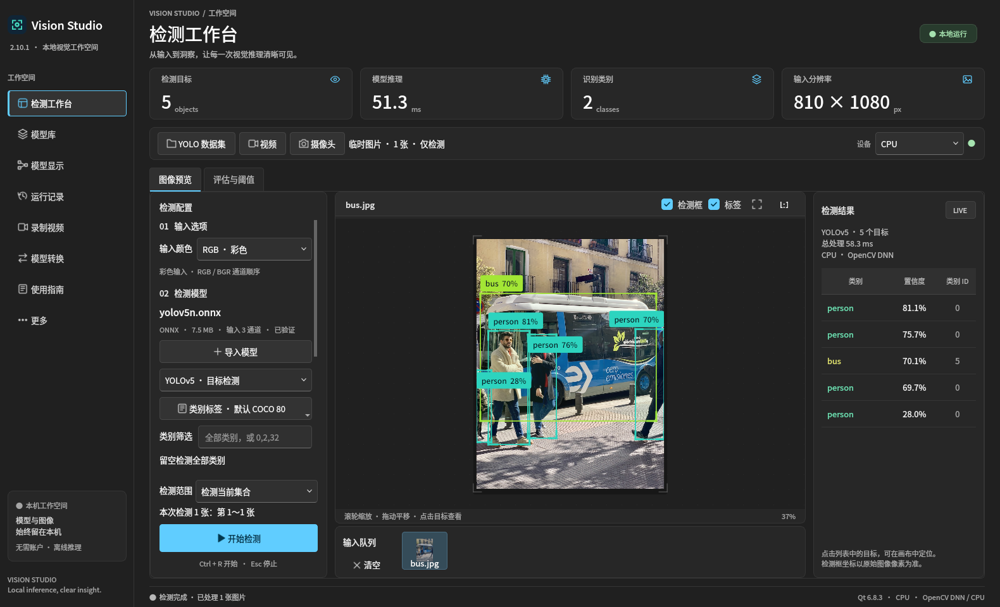
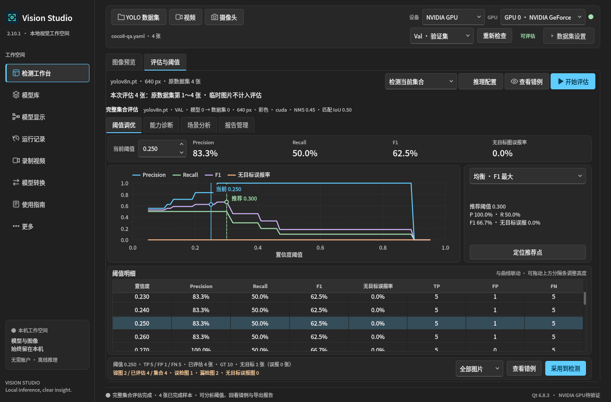
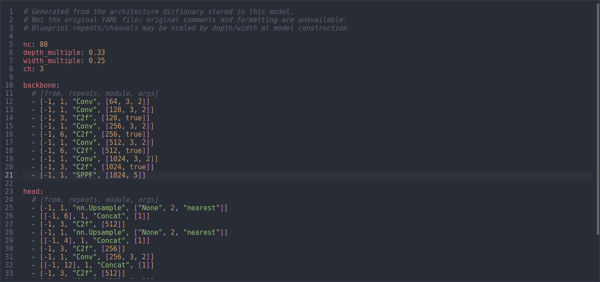

# Vision Studio

**在本机运行 YOLO 模型，用标注数据集评估表现，再将选定配置用于实际检测。**

Vision Studio 是基于 C++17 / Qt 6.8 的视觉模型工作台，面向需要调试模型、分析误检漏检和选择置信度阈值的开发者与研究者。它将检测预览、目标类评估、模型结构查看与格式转换放在同一个 Fluent 深色界面中。

[下载](#下载与快速开始) · [首次使用](docs/使用指南.md#1-选模型完成第一次检测) · [文档](docs/README.md) · [反馈问题](https://github.com/misaka-ning/vision-studio/issues) · [视频介绍](https://www.bilibili.com/video/BV1s8pe6cEXb/)

## 技术阅读入口

[两个工程案例：异步关闭与线程回收、结果背压与配置隔离](docs/architecture/技术阅读入口.md) —— 从触发条件和取舍追到源码、测试及历史 PR；[完整架构](docs/architecture/应用架构.md)列出状态与依赖边界。

## 核心能力

| 能力 | 可以完成什么 |
| --- | --- |
| 本地检测 | 使用 YOLO 数据集、拖入的图片、视频或摄像头；选择检测范围与原始类别 ID，停止后回看已完成结果 |
| 评估与阈值 | 对照真实标注，分析目标类 AP、Precision、Recall、F1 和无目标图片误报率；比较阈值、逐图排查错例，明确采用配置后继续检测 |
| 模型管理与查看 | 全局选用模型，管理排序、名称和备注；查看 Netron 结构图、层级树、参数表及可用的 YOLO YAML |
| 模型转换 | 将受支持的 PT／TorchScript 导出为 ONNX 或 TorchScript，保留任务、类别和输入通道信息 |
| 输入与计算设备 | CPU 或可选 NVIDIA GPU 推理；灰度 C1／C3 适配，水平左右拼接视频的单目选择 |
| 结果与报告 | 导出 PNG／JSON／CSV、标注录像与评估报告；回看历史快照，生成 PNG／SVG／PDF 图表和 LaTeX 表格行 |

## 代表截图

**检测工作台** — 2.10.1 完整对应源码独立重建后的真实程序，公开 bus 图片与 YOLOv5n，使用 OpenCV DNN CPU。



**评估与阈值** — 2.10.1 最终 DEB 的真实 CUDA 流程检查，使用公开 COCO8 的四张 Val 图片。



两张截图均直接引用既有原件，来源见[界面检查记录](docs/releases/evidence/2.10.1/final-visual-review/README.md)。图中耗时与小样本指标用于展示流程，不代表通用性能或足球任务精度。

<details>
<summary>查看 YOLO YAML 代码视图（2.8.0 历史截图）</summary>



来自 2.8.0 生产 UI 对象的真实 Qt 渲染，使用公开 YOLOv8n；[来源记录](docs/releases/evidence/2.8.0/screenshots.json)。显示模型实际保存的架构字典，不还原原始训练 YAML 的注释或排版。

</details>

## 下载与快速开始

Linux 与 Windows 分别发布，当前版本不同：

| 平台 | 已发布版本 | 下载入口 |
| --- | --- | --- |
| Ubuntu 22.04 amd64 | **2.10.1** | [Linux Release](https://github.com/misaka-ning/vision-studio/releases/tag/v2.10.1) · `vision-studio_2.10.1-1_amd64.deb` |
| Windows x64 | **2.9.1** | [Windows Release](https://github.com/misaka-ning/vision-studio/releases/tag/v2.9.1) · 选择下方一个 EXE |

### Linux 安装

将 DEB 与同版 `SHA256SUMS` 放在同一目录，校验已下载的附件后安装：

```bash
sha256sum --ignore-missing -c SHA256SUMS
sudo apt install ./vision-studio_2.10.1-1_amd64.deb
vision-studio
```

默认安装到 `/opt/VisionStudio`，DEB 已包含 CPU／Netron 运行环境；APT 仍可能需要获取系统依赖。普通使用无需下载完整源码包。

### Windows 安装

- **离线包**：`vision-studio-2.9.1-windows-x64-offline-setup.exe`，包含完整 CPU 运行环境。
- **在线包**：`vision-studio-2.9.1-windows-x64-online-setup.exe`，先提供 ONNX 推理；PT、模型视图、转换与数据集导入／评估等功能首次按需准备共用环境。

普通用户只需一个 EXE，校验值见同页 `SHA256SUMS-windows-x64`。两包都不安装源码、示例模型或测试图片。网络不稳定或需要离线分发时，优先选择离线包；在线包补齐环境后的占用接近离线包。[双包与下载限制说明](docs/releases/2.9.1-windows.md) · [校验与个人数据位置](docs/使用指南.md#安装与个人数据)

### 完成第一次检测

1. 在「模型库」导入并选用可信的 ONNX、完整 PT 或兼容 TorchScript 模型。
2. 在「图像预览」拖入自己的图片／视频，或点击「YOLO 数据集」导入文件夹／YAML。先用 **CPU** 验证模型与输入。
3. 核对任务、输入尺寸及训练预处理，点击「开始检测」。完成后回看结果，按 `Ctrl+E` 导出当前图片。
4. 需要评估时，导入带正确标注的数据集，在「评估与阈值」核对类别映射后开始评估。

完整步骤见[使用指南](docs/使用指南.md)。NVIDIA GPU 首次在「更多」准备独立环境，需要网络与兼容驱动；不安装或修改驱动。环境就绪后可在本机离线推理。

### 从源码构建

开发者从[开发指南](docs/开发指南.md)开始：包含 Linux／Windows 构建条件、运行环境、测试和 GPU 配置。重建已发布的发行包请使用[完整对应源码与重建说明](docs/release/对应源码与重建.md)。

## 支持范围

| 项目 | 当前约定 |
| --- | --- |
| 推理后端 | ONNX CPU：C++ OpenCV DNN；ONNX NVIDIA GPU：C++ ONNX Runtime CUDA；PT／TorchScript：常驻本地 Python／PyTorch |
| 模型 | 符合输入输出约定的 YOLOv5、YOLOv8／YOLO11 原始检测输出与单标签分类；ONNX NCHW、batch=1、FP32、固定 C1／C3；PT 需完整且兼容的架构 |
| 评估 | 标准 YOLO 检测标注，评估映射的**单一目标类别**；界面 mAP 字段是该类 AP，不是多类总体 mAP |
| 平台验收 | Linux 2.10.1：Ubuntu 22.04 amd64；Windows 2.9.1：Windows 11 x64。Windows 2.10.1、Windows 10 与实体摄像头未验收 |

TensorRT、AMD／Intel GPU、分割、姿态、旋转框和未知端到端输出不在当前支持范围；不提供模型训练或双目测距。ONNX 和 PT 的算子、元数据与预处理仍需逐模型核对；**能够查看结构不代表能够推理**。PT 检查点载入可能执行 Python 代码，请只使用可信文件。

[模型兼容与转换约定](docs/模型说明.md#推理兼容范围) · [评估口径与限制](docs/使用指南.md#4-评估模型并选择阈值) · [CPU／GPU 设置](docs/使用指南.md#cpu-与-nvidia-gpu)

## 文档导航

| 我想了解 | 入口 |
| --- | --- |
| 按任务查找文档 | [文档中心](docs/README.md) |
| 检测、数据集、评估、阈值、错例与导出 | [使用指南](docs/使用指南.md) |
| 模型输入输出、YAML、转换和示例来源 | [模型说明](docs/模型说明.md) |
| 从源码运行、测试与调试 | [开发指南](docs/开发指南.md) |
| 模块职责、数据流与异步关闭 | [应用架构](docs/architecture/应用架构.md) |
| 变化与实际验收范围 | [更新日志](CHANGELOG.md) · [Linux 2.10.1](docs/releases/2.10.1.md) · [Windows 2.9.1](docs/releases/2.9.1-windows.md) |
| 打包、对应源码与发布 | [Linux 打包](packaging/README.md) · [Windows 打包](packaging/windows/README.md) · [版本管理](docs/版本管理.md) |

## 贡献与许可

请通过 [Issues](https://github.com/misaka-ning/vision-studio/issues) 反馈问题或讨论需求，通过 Pull Request 提交改进；复现信息和开发约定见[参与贡献](CONTRIBUTING.md)。维护者：misaka_ning，1468549029@qq.com。

应用代码采用 **[AGPL-3.0-only](LICENSE)**。Qt、Ultralytics、YOLOv5、Netron、示例模型及其他组件保留各自许可，详见[第三方许可清单](docs/release/第三方许可清单.md)与[原始通知](packaging/licenses/)。

Linux Release 同时提供 `vision-studio-2.10.1-complete-source.tar.xz` 和 `SHA256SUMS`；Windows 另提供 `vision-studio-2.9.1-windows-sources.zip` 及独立校验清单，并沿用同版共享上游源码。GitHub 自动生成的 Source code ZIP／tar.gz **不能替代完整对应源码包**。获取、校验与重建见[对应源码说明](docs/release/对应源码与重建.md)和[Windows 源码说明](packaging/windows/README.md#重建)；转发发行版时请保留对应源码、许可通知与校验文件。
