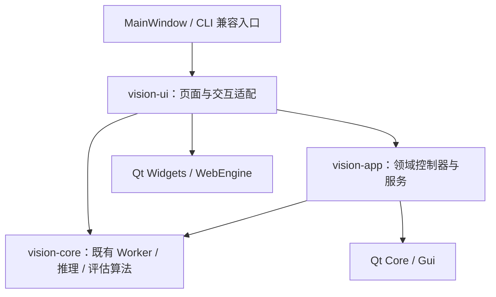
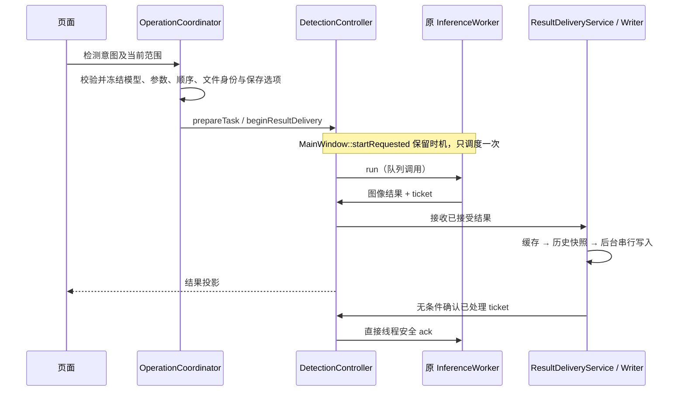

# Vision Studio 应用架构

本文记录 MainWindow 职责拆分的代码边界。分阶段构建与回归记录见 [迁移进度](refactor-progress.md)；最终发行状态以同版发行说明和验收证据为准，开发测试不替代安装包验收。

## 构建依赖

`src/app` 不包含具体页面、MainWindow、QWidget 或 Qt Widgets／WebEngine 依赖。Qt Gui 用于 QImage、颜色和后台标注绘制；并不要求创建 QWidget。`vision-ui` 负责控件、弹窗、拖放与桌面操作。

ONNX CPU 继续使用 C++ OpenCV DNN；ONNX CUDA 继续使用 C++ ONNX Runtime；PT／TorchScript 沿用常驻 Python／PyTorch。此次拆分不替换后端、模型协议、推理算法或运行依赖。

## 唯一可写状态

| 权威模块 | 持有的状态及职责 | 对外接口 |
| --- | --- | --- |
| ModelSessionController | 模型顺序、全局选择、名称、备注、转换／评估关联、类别及通道检查 | 命令、只读 ModelSessionSnapshot、独立 inspection generation |
| WorkbenchConfiguration | 编辑中的双精度阈值、推理参数、标签与原始类别筛选、颜色、单目、设备偏好、自动保存目录 | WorkbenchDraft、compose、类别校验、配置指纹 |
| InputSessionController | 输入顺序及选中项、数据集与临时图片、导入／取消、启动恢复 | InputSessionSnapshot、分批投影信号与确认、三种范围查询 |
| DetectionController | 推理 Worker／线程、不可变任务快照、进度／停止／失败、ticket 确认 | DetectionTaskSnapshot、直接停止、结果交付、异步关闭 |
| ResultDeliveryService | 检测缓存与 serial ResultWriter、任务冻结的保存选项、历史结果交付 | 缓存查询／失效命令、结果接收、保存状态及通知 |
| EvaluationController | 评估 Worker、报告与历史配置快照、阈值重分析、错例筛选与预览任务 | EvaluationState、独立筛选／预览 generation、显式采用配置补丁 |
| RecordingController | 录制请求与展示状态、录像清单、播放／解码／导出线程 | 值快照、录制命令、播放帧与通知；实际编码仍在原 InferenceWorker |
| OperationCoordinator | 独立活动权限、跨模块任务计划及停止协调、异步关闭屏障 | ActivitySnapshot／OperationAvailability、PreparedDetectionTask、关闭协议 |
| PreferencesRepository / HistoryRepository | 既有 INI 键及历史 JSON；历史条目唯一可写来源 | typed workspace 保存、只读历史快照、追加与导出 |
| GpuEnvironmentService | 环境检查与准备的辅助进程、日志、进度、超时与取消 | 状态／日志信号、requestShutdown |

页面不另存一份可独立修改的模型、输入或评估业务数据。模型行、队列项目、画布结果与设备标签属于展示投影；其来源仍是上表模块。MainWindow 保留顶层页面装配、导航、信号适配、文件选择对话框与 CLI／Smoke 兼容入口，不再持有 Worker、QProcess、业务缓存映射或保存队列。

WorkbenchPage 先发出类型明确的单字段编辑意图，WorkbenchConfiguration 只修改该字段；changed 信号再以 QSignalBlocker 将权威值投影回页面。没有从整张控件表回采配置的常规路径，GPU 设备列表刷新也只读取草稿。初始化、转换元数据和显式采用评估配置保留原有 Qt 控件的精度与范围归一化。

`OperationCoordinator` 不复制领域内部状态。其 activity provider 即时查询各资源所有者；单独追踪检测、导入、队列投影、评估、转换、GPU 准备、保存、模态界面和关闭。`VisibleTask` 仅选择当前展示哪一份领域进度，不重复保存计数或任务文件。

## 页面和导航

`src/ui/pages` 包含 WorkbenchPage、ModelsLibraryPage、ModelDisplayPage、HistoryPage、RecordingsPage、MorePage、GuidePage。工作台保留图像预览与评估子页，控件的 objectName、列表 UserRole、快捷键及焦点顺序保持。

Route 的历史数值为：工作台 0、模型库 1、模型显示 2、记录 3、指南 4、录像 5、转换 6、更多 7。侧栏显示顺序仍是 0、1、2、3、5、6、4、7。导航按钮增加稳定的 `navigation-N` 查询名。

WorkbenchPage 独立持有局部画布／配置展示、设备显示、队列投影计时器及原图预览 loader。投影仍采用每片最多 96 项／5 ms 的既有预算，携带 InputSessionController 的 generation，最终确认后才提交恢复记录。异步原图只允许最新请求刷新画布。

WorkspaceDropFilter 由各页面拥有，仅接收该页面祖先范围的事件；本地 URL 校验、Copy／拒绝行为和 hover 状态保持，列表 InternalMove 仍交回 QListWidget。导入意图通过同步 token 确认，页面不拥有导入任务或修改模型状态。模型菜单与备注／名称对话框属于 ModelsLibraryPage，结束时重新检查权限和模型身份。

ModelViewer、ModelConversionPage 保留原有内部封装，作为已有页面执行能力的明确例外；此次只补充异步关闭、退出中进程及清理资源的可观测生命周期，不将其内部实现复制到应用控制器。

## 任务与结果流

Worker 的图像结果背压仍是等待当前 ticket 确认后再继续。结果 ticket 在成功、失败、取消和过期路径都有明确释放路径；过期写入不能覆盖新一代缓存。停止调用原线程安全接口唤醒 Worker，不排队等待其事件循环，按钮回调不等待推理或磁盘。

缓存绑定模型／参数指纹、源文件身份及 generation。相同配置的子范围重跑保留范围外有效结果；参数变化或源文件被替换时按原规则失效。临时 PNG 成功落盘后才释放缓存中的图像像素，失败保留内存结果并通知。临时目录由已接受写入的 shared ownership 保持，不能在保存中被提前删除。

视频／摄像头最后一帧在 Worker 完成后由同一交付服务串行保存历史及自动导出，完成通知随后发出。关闭会等待这条已接受的收尾链结束，不把保存工作转回 GUI 线程。

实际设备来自 Worker 的 loaded configuration／InferenceResult。GPU 环境探针只说明环境可用性，不能据此标记本次推理使用 CUDA。

## 评估隔离

检测缓存与历史评估报告是不同的数据域。EvaluationController 保存报告原有配置及文件快照；切换页面、分析阈值、打开历史报告或浏览错例不会修改检测配置。只有显式采用动作生成配置补丁并写回 WorkbenchConfiguration。

筛选与预览使用各自 generation。异步筛选完成时保留仍可见的当前用户选择，显式“查看错例”才定位首项；失败的外部导入／重分析恢复旧报告回看，不把取消掉的预览误当作已经可用。

## 异步关闭

窗口收到关闭请求后忽略首次 close event，禁用窗口并进入不可提交新操作的关闭状态，向每个资源所有者发送 requestShutdown。运行时准备入口与已排队的成功重试也分别拒绝关闭后的操作。OperationCoordinator 保持 GUI 事件循环，查询各所有者的 isShutdownReady，全部就绪后才再次关闭窗口。

屏障覆盖：输入／恢复任务、模型检查、评估与错例后台任务、检测及结果写入、录像播放／导出、GPU 检查与准备、ModelViewer 活跃及 retiring 进程、转换 helper 与清理任务、页面原图预览、全局缩略图／预览线程池，以及运行时准备。GUI 不调用 QThread::wait／waitForDone，不强制终止 C++ 线程。

`QThread::finished`／`isFinished()` 仍可能处于 DeferredDelete 或线程局部对象析构阶段，不能直接作为 native 线程已经完全退出的证明。`AsyncThreadRetirement` 在启动前接管独立 QThread 的回收：结束信号只触发后台 `wait()`，GUI 事件循环观察 join 确认后才清除所有者的活动记录、安全删除线程对象并释放应用级回收屏障。Ticket 不随业务所有者析构；即使所有者提前消失，仍完成 join 与回收，不调用已失效的所有者回调。该辅助类仅依赖既有 Qt Core 和 C++17，运行时准备的独立目标也可复用；没有 GUI 线程同步等待。此边界符合 [Qt 6.8 的线程完成说明](https://doc.qt.io/qt-6.8/qthread.html#isFinished)。

同步状态信号可能重入关闭：输入与评估在通知返回后再次检查启动许可，录像导出先把已接受的复制操作入队，再通知展示状态。页面析构在子控件释放前断开跨子控件回调，避免 Viewer 临终信号访问先释放的标签。

窗口级关闭只取消运行时准备，不永久关闭 QApplication 共享服务；取消 generation 同时拦截已经排队的旧成功重试。CLI 使用 requestExit 保留退出码，先经过同一屏障再退出事件循环。转换的已核验发布文件在最终 result 通知开始前进入不可回滚完成点，避免 UI 已接受成功后取消 helper 删除输出。

## 测试与交付

六个旧 friend 测试改为页面用户意图、控制器命令／信号和只读快照，保留原业务断言。独立服务与页面测试覆盖状态归属、身份失效、错误和生命周期；窗口关闭测试先等待收尾，再析构，不能用析构阻塞掩盖未完成资源。

最终必须重新执行全部注册测试、真实 CPU／CUDA、PT／TorchScript、灰度 C1／C3、单目、录制、转换及各 CLI Smoke；最终 DEB 和完整源码包的验收与独立重建另行绑定产物 SHA256。Windows 未实际执行的检查明确列为未验证。
