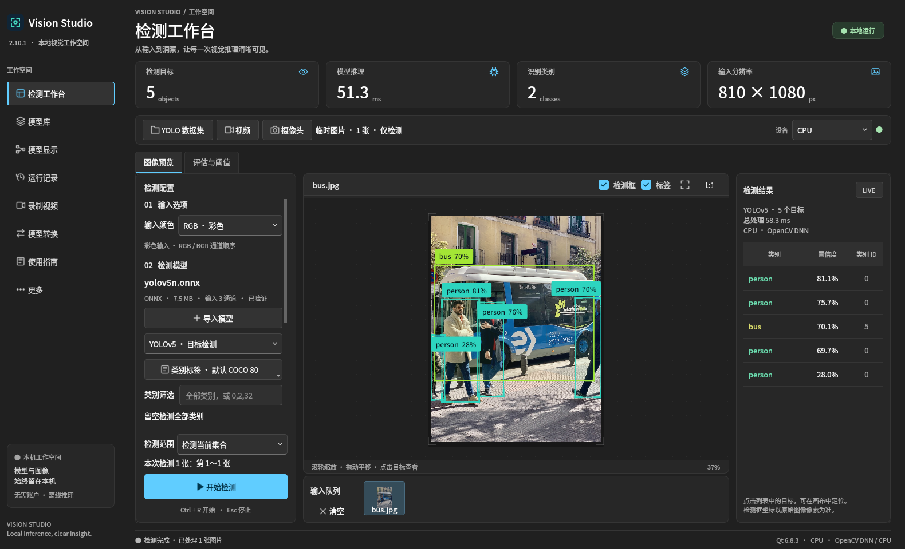
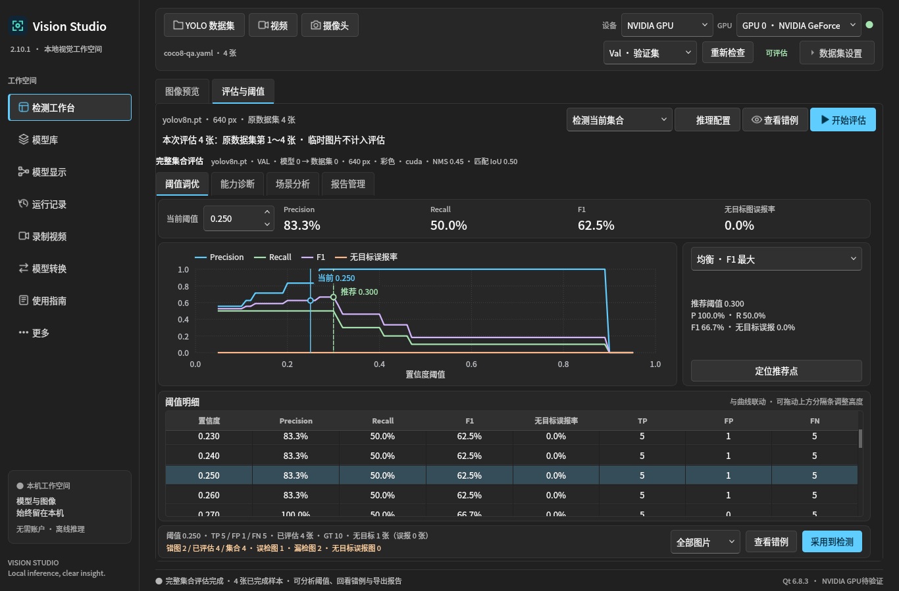

# 独立重建程序的实际界面检查

下图来自完整对应源码附件独立重建后的真实 ONNX CPU Smoke，使用项目既有公开 bus 图片及 YOLOv5n。截图未经编辑；画布、目标表和实际后端标签正常显示。仅核对这一视图的布局，不作为精度或性能基准。原件身份见 [review.json](review.json)。

下图来自最终只读 DEB 的公开 COCO8 四张 Val 图像 CUDA 流程检查，核对图表、阈值表、推荐区及控件布局。图中指标仅为该小样本流程结果，不代表足球任务精度。

