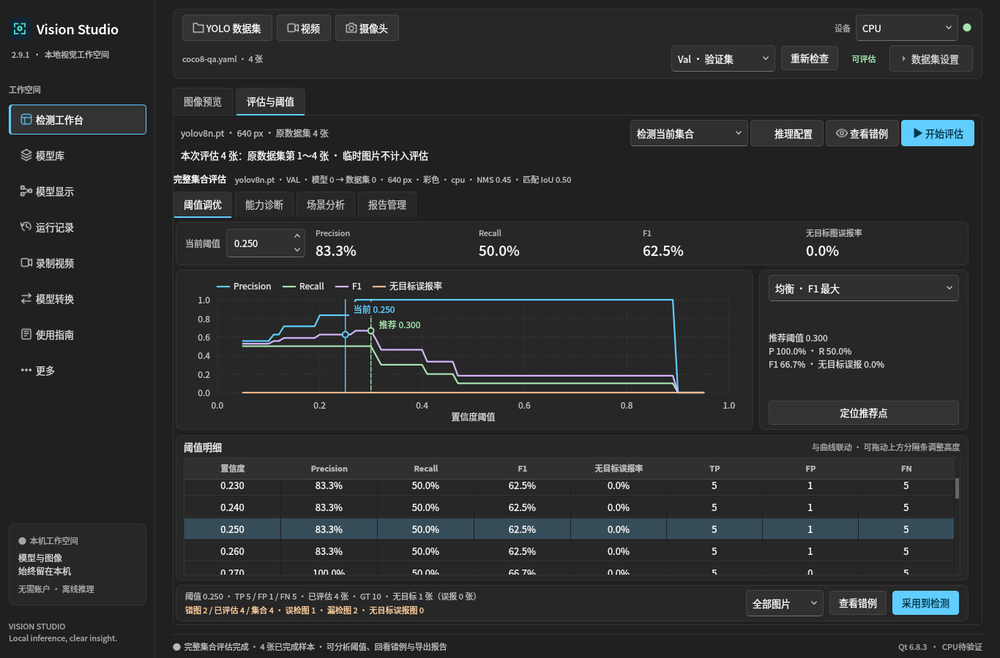

# Vision Studio 2.9.1 验收

本版将推荐决策、曲线、当前指标和阈值明细合并为默认「阈值调优」页，另设能力诊断、场景分析和报告管理。保持 C++17／Qt 6.8.3、Fluent 深色界面及既有 CPU／CUDA 后端，无新增运行依赖。

生产输入冻结于 `de3ae8a15566060a9c815e2c5e454861c60c4a33`。完整回归前后、最终包构建及验收时重新读取生产输入、测试日志和应用指纹；后续提交仅补充证据、截图及发行说明。完整对应源码包保留该次冻结源码和上游资料，不重新打包覆盖。

| 实际执行范围 | 结果 |
| --- | --- |
| 单轮完整生产回归 | 26 套；426 项 Qt（含初始化／清理）、155 项 Python；零失败／跳过／blacklisted |
| 最终只读包后端矩阵 | ONNX CPU／CUDA、PT CPU／CUDA、TorchScript CPU、原始 ID 32 零匹配，以及三组同权重后端对照通过 |
| 评估扩展 | CPU／CUDA 各四组真实运行，batch 与尾批、审核分组、匹配 IoU、九图三格式、两组离线重分析通过 |
| 侧栏专项 | CPU／CUDA 各 25 项：同页联动、独立配置采用、可调分隔、错例回看与返回、原报告不变 |
| 窗口与可读性 | 两种尺寸 × 三种策略 × 两后端；原生文字需求、全部祖先裁切、初始当前行与首次稳定布局观测通过；根代理逐张目检 12 张实际截图 |
| 输入与已有功能 | 文件夹／YAML、迁移、队列、停止回看、当前图片导出、独立进程数据集恢复、拖入、YOLO YAML 与启动偏好通过 |
| 外部脚本报告 | 最终包实际重新导入历史快照，16 项校验通过；保留原始 ID、未知信息与禁止采用配置语义，来源原件不变 |
| 交付物 | 完整对应源码逐成员检查、只读 CPU 推理／导出、APT 模拟、隔离离线安装／启动／卸载通过；隔离安装中保留用户数据，宿主系统不变 |

原始记录完整保存在本地 Git 外，包含完整单轮日志、请求、报告、布局观测及失败诊断，不以摘录或旧版通过结果充当新验收。本版验收编排的两处历史前置路径曾误指向不存在的同版目录；失败报告、聚合日志和工具原字节已保全。仅修正 Git 外工具，显式引用已存在的历史快照，在同一最终包上重新执行与重开后通过，未修改产品或放宽校验。

公开目录只保存静态白名单结果、整体原件 SHA256 承诺和经人工审阅的公开 COCO8 截图；原始命令、主机路径、私人数据与逐文件身份留在本地。公开投影不是最终门禁输入。`original-commitments.json` 以安全报告角色列出整个文件的校验值，并对完整原件树作规范化 SHA256 承诺；文件数包含未逐项公开的私人原件。`raw-gate-commitments.json` 绑定实际重开的最终聚合、原生回归和侧栏门禁。六个本地 QA 归档不作为 Release 附件。

- [回归与结果投影](reports/finalize-reports.json)、[侧栏专项](reports/packaged-decision-layout-qa.json)
- [最终资产身份](final-assets.json)、[校验清单](SHA256SUMS)
- [原件承诺](original-commitments.json)、[门禁承诺](raw-gate-commitments.json)、[截图来源](screenshots.json)

截图来自实际 2.9.1 最终只读 DEB，公开 COCO8 四张 Val 图片、随附 YOLOv8n 与 CPU；最小窗口图及双标记图见截图来源。测试只验证流程、数值一致性与布局，不是足球精度、泛化能力或速度基准。困难场景审核使用明确的合成标记测试管线，不冒充真实人工审核数据。

普通应用最小尺寸保持 1260×820，另检查 1366×900；独立面板更小尺寸的压力测试不代表整应用支持 768 像素高度。未执行 Windows 2.9.1、物理摄像头、Jetson／ZED／TensorRT 或新性能基准；不会把已有水平左右目裁剪描述为立体测距。发布与本地保留结果见下方维护记录。

2026-10-23 维护核验：[2.9.1](https://github.com/misaka-ning/vision-studio/releases/tag/v2.9.1) 已正式公开并为 Latest；带说明标签及三个附件的大小／SHA256 经独立复核。主目录源码和发行文件已同步，两份本地发行根仅保留 2.9.1／2.9.0；四处旧生成目录和两处旧发行目录已精确清理，旧 QA、元数据与开发构建保全归档仍在。八份受保护用户文件及共享环境保持。进程检查无已知候选引用；受保护会话服务采用当轮精确身份审阅，不声称完整描述符可见性。详见[发布与保留记录](publication.json)，原始凭证保存在本地并作整体 SHA256 承诺。

宿主安装暂缓：实际仍安装 2.9.0-1，普通应用窗口正在运行，安装前检查在系统安装器启动前停止。退出旧程序后可继续安装同一已验收的 2.9.1 DEB；本节没有把隔离安装验收或 GitHub 发布当作宿主升级完成。
